# ForwardStep – Cloud Data Lakehouse

**Cloud Data Engineering | Databricks | Apache Spark | Delta Lake | Medallion Architecture | Data Quality | CI/CD**

## 📌 Overview

ForwardStep is an end-to-end cloud-based Lakehouse implementation designed around the operational needs of a mid-sized online footwear retailer. The business scenario represents approximately 5,000 customers, 20,000 annual orders, 500 products across 6 categories, and 3 warehouses.

The project addresses the challenge of consolidating data from multiple operational systems, file-based sources, and website interactions into a unified analytical platform. It implements a complete data engineering workflow, from synthetic source data generation and incremental ingestion to historical data management, business-oriented transformations, quality monitoring, automated testing, and deployment.

Built on Databricks, the solution follows the Medallion Architecture (Bronze, Silver, and Gold), using Databricks Auto Loader, Apache Spark, Delta Lake, and Unity Catalog to ingest, transform, organise, and govern data. CDC-formatted JSON feeds and file-based data are processed through Databricks-managed staging and landing volumes, with source-specific transformation strategies applied in the Silver layer.

The Gold layer delivers five analytical data marts covering daily revenue, customer insights, product performance, marketing conversion, and fulfilment health. The platform is supported by automated data-quality checks, quarantine handling, referential-integrity monitoring, Databricks Job orchestration, unit and integration testing, and CI/CD workflows using Databricks Asset Bundles and GitHub Actions, including deployment to a separate production workspace.

---

## 🎯 Business Challenges

The retailer's operational data is distributed across different systems, file exports, and website event records. As a result, departments rely on manual data extraction, spreadsheet consolidation, and outdated reports to answer important business questions. This creates reporting delays, inconsistent figures, and limited visibility into customer behaviour, sales performance, and inventory.

The project addresses five key business challenges:

### 💰 1. Delayed & Inconsistent Financial Reporting

The Finance team relies on manually combining data exported from three different sources to produce its daily revenue report. The process is time-consuming, causes the report to arrive a day late, and has already resulted in discrepancies between reported figures.

Business requirement: Consolidate order, order-item, and product information into a reliable revenue data mart, enabling analysis of revenue by date, product category, and region.

### 👥 2. Limited Customer Visibility

Customer profiles, purchase history, and loyalty information are distributed across separate systems. Marketing cannot easily identify high-value customers, understand purchasing behaviour, or recognise customers showing signs of churn without manually cross-referencing multiple spreadsheets.

Business requirement: Bring customer and order history together into a unified Customer 360 view, providing customer-level metrics such as lifetime value, order frequency, and days since last purchase.

### 📦 3. Inefficient Inventory & Stock Management

Inventory decisions are often based on outdated reports and manual estimates. Stock levels from three warehouses are provided through periodic file exports, making it difficult to compare current inventory against product demand. Popular sizes risk becoming unavailable while slower-moving products accumulate as excess stock.

Business requirement: Combine sales performance with current inventory data to identify product demand, stock levels, and potential stockout risks.

### 📈 4. Limited Marketing Conversion Insights

Website interactions, including clicks, searches, and add-to-cart events, generate valuable behavioural data, but this information is not being used effectively alongside completed orders. The business lacks a consolidated view of how website activity translates into purchases across marketing channels.

Business requirement: Integrate clickstream events with order data to analyse customer journeys and conversion performance by marketing referrer.

### 🚚 5. Limited Fulfilment Performance Visibility

The Operations team needs to understand whether customer orders are being fulfilled within their promised delivery timelines. Without consolidated order and fulfilment information, identifying delivery-performance issues across different dates and regions is difficult.

Business requirement: Provide a dedicated fulfilment data mart to monitor delivery SLA performance by date and region.

These requirements form the foundation for the five Gold-layer analytical data marts developed in ForwardStep, giving each business function access to structured data aligned with its reporting needs.

---

## 🏗️ System Architecture

ForwardStep follows a **Medallion Lakehouse Architecture** on Databricks, separating data ingestion, transformation, and business-oriented analytics into Bronze, Silver, and Gold layers.

The architecture integrates seven retail data sources using two ingestion patterns: CDC-format JSON feeds for transactional data and file-based ingestion for product, category, clickstream, and inventory data. All source files pass through Databricks-managed staging and landing volumes before entering the ingestion pipeline.

The following diagram illustrates the complete data flow, from synthetic source data generation to the Gold analytical data marts:

<div style="
    width: min(94vw, 1600px);
    max-width: none;
    position: relative;
    left: 50%;
    transform: translateX(-50%);
    margin: 2rem 0;
">
    <a href="./project_graph.svg" target="_blank" rel="noopener">
        
    </a>
</div>


The architecture is organised around three main processing layers:

### 🥉 Bronze – Raw Data Ingestion

The ingestion pipeline uses **Databricks Auto Loader** to incrementally process incoming JSON and CSV files from the landing volume. Explicit schemas define the expected structure of each source.

CDC-format records retain their original envelope, including operation type, timestamps, before-images, and after-images. File-based records are ingested in their original record structure, with additional ingestion metadata attached.

Structural quality expectations are applied separately from the raw ingestion tables. Records are classified into valid and quarantined outputs, allowing downstream transformations to consume validated data while retaining problematic records for investigation.

### 🥈 Silver – Data Transformation

The transformation pipeline consumes the validated Bronze tables and applies source-specific processing using **Apache Spark and Delta Lake**.

This includes data type standardisation, business-rule validation, CDC processing, and historical record management.

Different source types use different historical-data strategies:

- **SCD Type 2:** Orders and customers, preserving changes to order status and customer profiles over time.
- **SCD Type 1:** Order items, products, and categories, maintaining their latest state.
- **Append-only processing:** Clickstream events and inventory snapshots, preserving individual events and historical snapshots.

Additional quality rules are applied during transformation. For example, order-item records with incorrect line totals are separated into a dedicated quarantine table rather than being included in downstream revenue calculations.

### 🥇 Gold – Business Analytics

The Gold layer contains five business-oriented analytical data marts built from the validated Silver datasets.

Each output is designed around a different department's reporting requirements:

- Daily Revenue
- Customer 360
- Product Performance
- Funnel Analysis
- Fulfilment Health

This separation provides downstream users with structured datasets tailored to their analytical requirements instead of requiring them to repeatedly query and join raw operational data.

### 🛡️ Governance & Data Quality Monitoring

**Unity Catalog** provides the organisational structure for project data, with a dedicated schema and separate Databricks-managed volumes for staging and landing.

Data quality monitoring extends beyond individual pipeline transformations. The implementation includes quarantine tracking, pipeline event-log monitoring, and eight referential-integrity checks using anti-joins to identify orphaned records across related datasets.


---

## 📥 Data Ingestion & Bronze Layer

The ingestion layer establishes the foundation of ForwardStep's Lakehouse by collecting data from seven simulated retail datasets and loading it into **Bronze Delta tables** using **Databricks Auto Loader**.

The implementation combines CDC-format JSON feeds for transactional data with CSV and JSON file ingestion for the remaining sources. Before entering the ingestion pipeline, generated data is organised through separate staging and landing volumes within Unity Catalog.

### 🗂️ Synthetic Source Data Generation

A standalone **Python data generator**, using the Faker library, produces interconnected datasets that simulate the retailer's operational systems. It supports both an initial full dataset and subsequent incremental batches containing new records and updates to existing entities.

The seven generated source datasets are:

| Source dataset | Input format | Initial dataset size |
|---|---|---:|
| Customers | CDC-format JSON | 5,000 |
| Orders | CDC-format JSON | 20,000 |
| Order Items | CDC-format JSON | ≈38,000 |
| Products | CSV | 500 |
| Categories | CSV | 6 |
| Clickstream | JSON | 180,000 |
| Inventory | CSV | 45,000 |

The initial dataset represents one year of order and website interaction history, alongside 30 days of inventory snapshots across three warehouses.

Subsequent batches simulate ongoing business activity, including new customers and orders, customer profile changes, order-status updates, product additions and updates, additional website events, and new inventory snapshots. A persistent generator state maintains entity identifiers and relationships across batches.

### 📂 Staging & Landing Volumes

Generated files are initially written locally and then uploaded into a dedicated **Databricks-managed staging volume**. A separate data-loader notebook transfers the selected batch into the landing volume, organising files into seven source-specific subdirectories.

```text
Generated Data
      ↓
Local Batch Directory
      ↓
Databricks Staging Volume
      ↓
Data Loader Notebook
      ↓
Databricks Landing Volume
      ↓
Bronze Ingestion Pipeline
```

The data-loader notebook accepts a batch number as a parameter, checks which source folders are available, and copies their contents from staging to landing. It also performs source-level row-count checks after the transfer to verify that the expected files are available.

This separation keeps the incoming batch files organised and provides a controlled starting point for ingestion.

### ⚡ Incremental Ingestion with Databricks Auto Loader

The Bronze ingestion pipeline uses **Databricks Auto Loader (`cloudFiles`)** to incrementally discover and process incoming files from the landing volume.

All seven sources use explicitly declared **PySpark schemas**, rather than relying on automatic schema inference. This provides a defined structure for the known datasets and keeps the ingestion contracts consistent across sources.

The implementation follows two ingestion patterns:

**CDC-format transactional sources**

Orders, order items, and customers are ingested from JSON files using schemas that preserve the complete CDC envelope:

- `op` – change operation type.
- `ts_ms` – source event timestamp.
- `before` – record state before the change.
- `after` – record state after the change.

The original envelope is retained in Bronze rather than flattening the business fields during ingestion. This preserves the incoming change information for downstream CDC processing in Silver.

**File-based sources**

Products, categories, and inventory are ingested from CSV files, while clickstream events are ingested from JSON files.

These sources already contain flat records, so they are loaded using their respective source schemas without introducing a CDC envelope.

For both ingestion patterns, the pipeline adds two metadata columns:

- `_ingested_at` – timestamp indicating when the record was ingested.
- `_source_file` – originating file path recorded from Databricks file metadata.

The seven raw datasets are written as **Bronze streaming Delta tables**, providing the ingestion layer for subsequent quality checks and transformations.

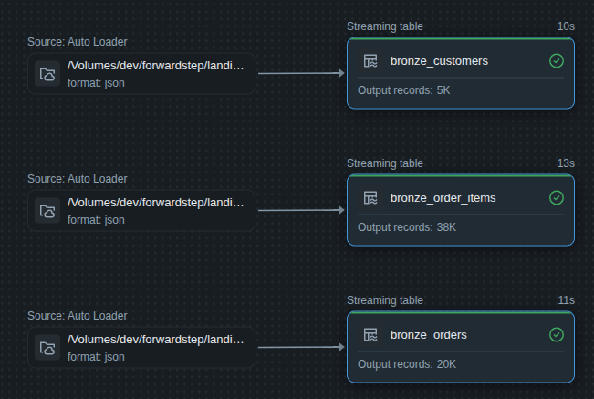

*Example ingestion results for the three CDC sources: 5,000 customer records, approximately 38,000 order-item records, and 20,000 order records.*

### 🔄 Bronze Pipeline Execution

The completed ingestion pipeline brings together all seven source datasets, their raw Bronze tables, and the subsequent quality-check outputs.

The pipeline graphs below show the individual source flows and their resulting valid and quarantined tables. The validation rules and quarantine logic are covered in detail in the Data Quality & Monitoring section.


<div style="
    width: min(90vw, 1100px);
    margin: 2rem auto;
    text-align: center;
">
    <a href="./bronze_pipeline_p1.png" target="_blank" rel="noopener">
        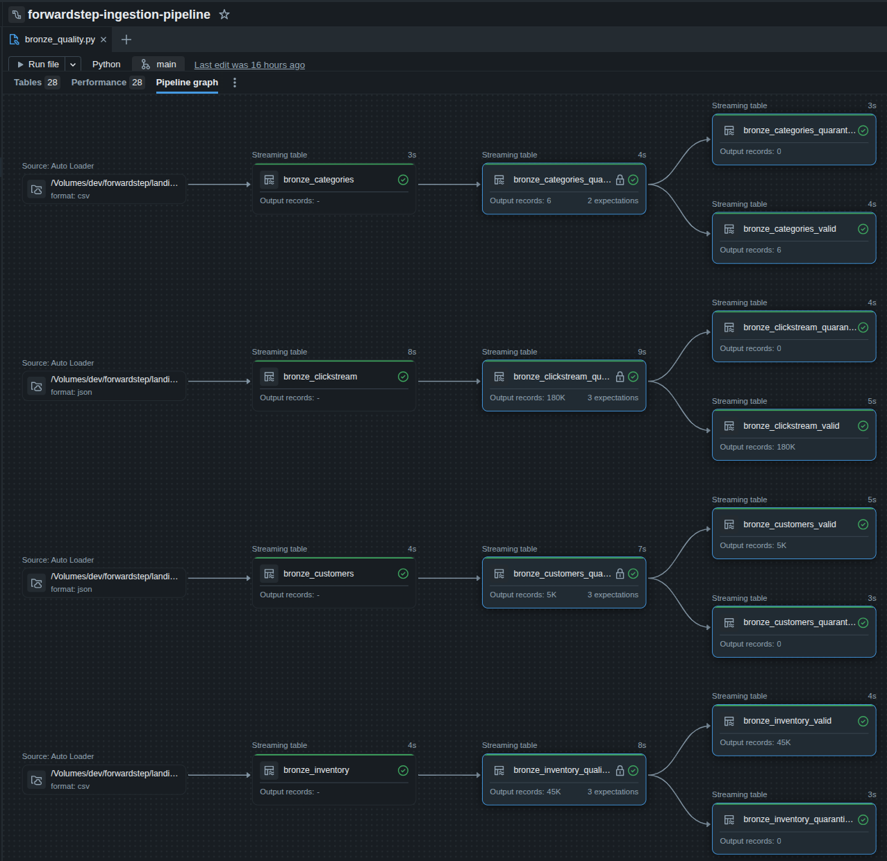
    </a>
</div>

*Bronze pipeline execution — file-based sources and their corresponding quality-check outputs.*

<div style="
    width: min(90vw, 1100px);
    margin: 2rem auto;
    text-align: center;
">
    <a href="./bronze_pipeline_p2.png" target="_blank" rel="noopener">
        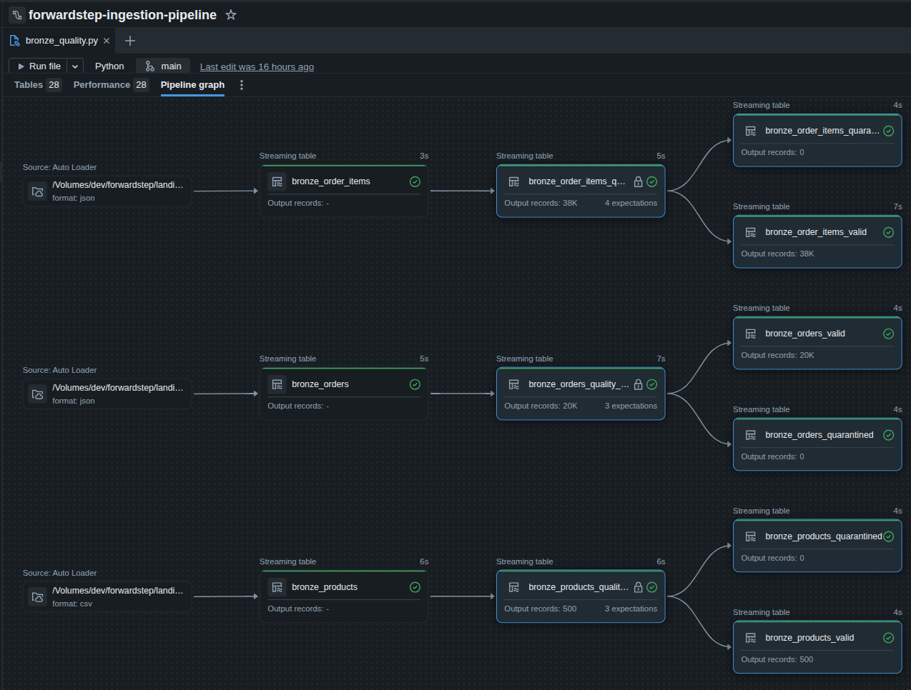
    </a>
</div>

*Bronze pipeline execution — transactional CDC sources and product catalogue ingestion, including the valid and quarantined outputs.*

By keeping ingestion separate from downstream transformations, the Bronze layer preserves the incoming source data and provides a consistent foundation for the Silver processing pipeline.

---

## ⚙️ Lakehouse Implementation – Silver Layer

The Silver layer is responsible for transforming the validated Bronze datasets into **conformed, structured Delta tables** ready for analytical processing.

Implemented using **Apache Spark and Databricks AUTO CDC**, the transformation pipeline applies source-specific processing strategies based on how each dataset changes over time. This includes historical tracking for transactional entities, current-state upserts for reference data, and append-only processing for event and inventory datasets.

In addition to standardising data types and structures, the Silver layer introduces **business-rule validation**, separating records that contain financially incorrect values from those suitable for downstream reporting.

### 🔄 CDC Processing & Historical Data Management

Three transactional sources arrive in Bronze as CDC-format JSON. In the Silver layer, their CDC envelopes are flattened to expose the underlying business records, while change operations and source timestamps are retained for processing.

The implementation uses **Databricks AUTO CDC** to apply changes based on entity keys and event sequence timestamps. Different Slowly Changing Dimension strategies are selected according to the business requirements of each source.

| Source | Processing strategy | Implementation |
|---|---|---|
| Orders | SCD Type 2 | Preserves order-status history using `order_id` and source event timestamps. |
| Customers | SCD Type 2 | Preserves customer-profile and loyalty-tier changes using `customer_id`. |
| Order Items | SCD Type 1 | Maintains the latest record for each `order_item_id`. |

**SCD Type 2** is particularly important for orders and customers because their attributes change over time. Rather than overwriting previous values, historical versions are retained, allowing downstream analysis to distinguish current records from earlier states.

**SCD Type 1** is used for order items because the analytical requirements focus on their latest state rather than historical versions of individual order lines.

For SCD Type 2 tables, the current record is identified using the `__END_AT` timestamp maintained by the CDC processing framework. Historical records remain available for temporal analysis, while Gold transformations can select the current version when calculating business metrics.

### 📦 File-Based Source Transformations

The remaining four sources follow processing strategies suited to their data characteristics.

- **Products:** SCD Type 1 upserts keyed by `product_id`, using ingestion timestamps to determine the latest version.
- **Categories:** SCD Type 1 upserts keyed by `category_id`.
- **Clickstream:** Append-only processing, retaining individual website interaction events.
- **Inventory:** Append-only processing, preserving daily stock snapshots rather than overwriting previous inventory records.

This distinction is important because product and category files represent changing reference data, whereas clickstream and inventory contain events or time-based snapshots that should remain available historically.

### 🧹 Data Conformance & Business-Rule Validation

The Silver pipeline standardises data types and applies business-oriented quality expectations before publishing the transformed datasets.

Date and timestamp fields arriving from Bronze as strings are converted into their appropriate Spark types. This includes order dates, customer dates, product launch dates, clickstream event timestamps, and inventory snapshot dates.

Business-rule expectations are defined according to the meaning of each source. Examples include valid order statuses, accepted customer loyalty tiers, product retail prices exceeding cost prices, and inventory quantities satisfying their business constraints.

Order items receive additional treatment because incorrect line totals would directly affect downstream revenue calculations.

The pipeline checks whether:

`line_total = quantity × unit_price`

Records failing this calculation are separated into a dedicated quarantine output, while the clean Silver order-items table contains only records that pass this check. Other configured Silver expectations are monitored without automatically blocking the individual records from being published.

### 🔍 Silver Transformation Pipeline

The transformation pipeline brings together the CDC-based and file-based processing flows, publishing the resulting Silver Delta tables.

<div style="
    width: min(94vw, 1600px);
    max-width: none;
    position: relative;
    left: 50%;
    transform: translateX(-50%);
    margin: 2rem 0;
">
    <a href="./silver_all_sources_pipeline_l87.png" target="_blank" rel="noopener">
        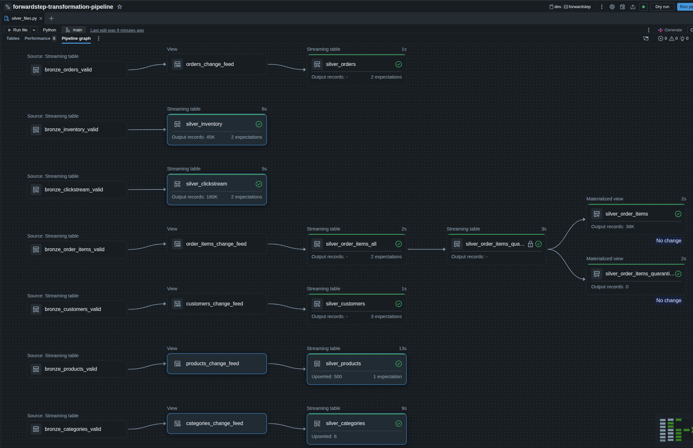
    </a>
</div>

*Silver pipeline execution across all seven source datasets. The captured run shows 180,000 clickstream events, 45,000 inventory snapshots, 500 products, and 6 categories processed, alongside the transactional datasets.*

The following view provides a closer look at the CDC processing flows and the order-item validation split.

<div style="
    width: min(94vw, 1600px);
    max-width: none;
    position: relative;
    left: 50%;
    transform: translateX(-50%);
    margin: 2rem 0;
">
    <a href="./silver_cdc_sources_pipeline_l85_skip.png" target="_blank" rel="noopener">
        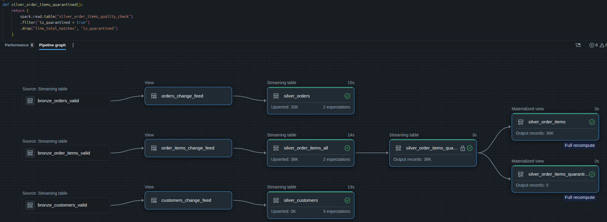
    </a>
</div>

*CDC processing results: 20,000 orders, 5,000 customers and approximately 38,000 order items. In this captured run, all 38,000 order items passed the line-total check, with no records routed to the quarantine output.*

The resulting Silver layer provides a consistent foundation for the Gold transformations, combining historical transactional information, current reference data, and append-only operational events.

---

## 📊 Data Modelling & Analytics – Gold Layer

The Gold layer transforms the conformed Silver datasets into **five business-oriented analytical data marts**, each designed to address a specific reporting requirement within the footwear retailer.

Implemented as **Databricks materialised views**, these outputs combine data from relevant Silver tables, apply business-specific calculations and aggregate information at appropriate analytical levels.

Rather than creating one large reporting table, the implementation separates the outputs according to their business purpose, allowing Finance, Marketing, Merchandising, Growth and Operations to consume datasets relevant to their respective requirements.

### 🏗️ Gold Transformation Pipeline

The Gold transformation pipeline builds five materialised views from the Silver layer:

<div style="
    width: min(94vw, 1600px);
    max-width: none;
    position: relative;
    left: 50%;
    transform: translateX(-50%);
    margin: 2rem 0;
">
    <a href="./gold_pipeline.png" target="_blank" rel="noopener">
        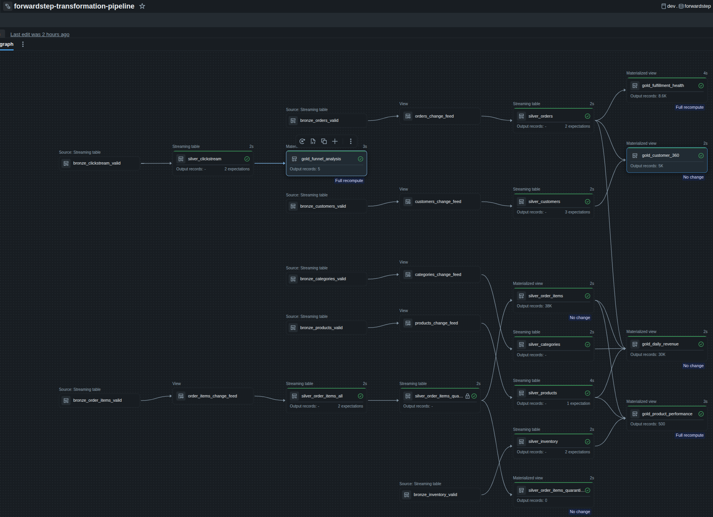
    </a>
</div>

*Gold pipeline execution showing five materialised views. In the captured run, the outputs contained approximately 30,000 Daily Revenue records, 5,000 Customer 360 records, 500 Product Performance records, 5 Funnel Analysis records and 8,600 Fulfilment Health records.*

The five data marts use the following source relationships and analytical grains:

| Gold data mart | Silver source tables | Analytical grain |
|---|---|---|
| `gold_daily_revenue` | Orders, Order Items, Products, Categories | Date, category and region |
| `gold_customer_360` | Customers, Orders | One record per customer |
| `gold_product_performance` | Order Items, Products, Inventory | One record per product |
| `gold_funnel_analysis` | Clickstream | Marketing referrer |
| `gold_fulfillment_health` | Orders | Order date and region |

### 💰 1. Daily Revenue – Finance

The Daily Revenue data mart consolidates transactional and product information to provide revenue reporting by date, category and shipping region.

It combines four Silver datasets:

- `silver_orders`
- `silver_order_items`
- `silver_products`
- `silver_categories`

The transformation calculates three separate financial metrics:

- **Gross Revenue:** Sum of order-item line totals.
- **Total Discount:** Order-level discounts allocated proportionally across individual order items.
- **Net Revenue:** Gross revenue minus the allocated discounts.

An important modelling consideration is that discounts exist at the order level, whereas reporting is required at the individual product-category level. Simply subtracting the full order discount from every line item would overstate the discount.

To avoid this, the transformation first calculates each order's subtotal and then distributes its discount according to each item's share of that subtotal:

```text
Allocated Discount =
    (Line Total / Order Subtotal)
    × Order Discount
```

The resulting values are aggregated by order date, product category and shipping region. Current order versions are selected from the SCD Type 2 Silver table to avoid including superseded order records.

The resulting view provides Finance with consistent gross, discount and net revenue figures at the required reporting level.

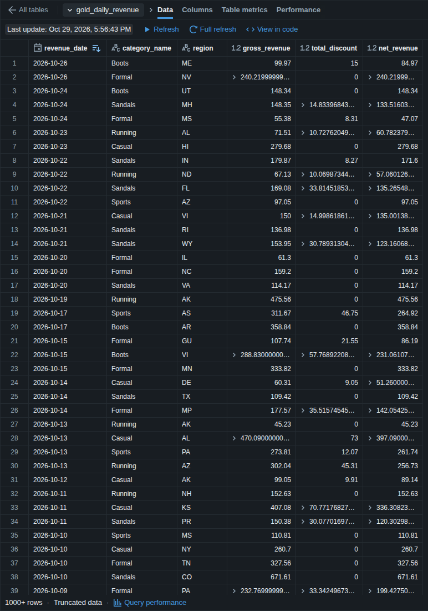

*Daily Revenue materialised view displaying gross revenue, allocated discounts and net revenue.*

### 👥 2. Customer 360 – Marketing

The Customer 360 data mart combines customer profiles with historical order information to create a consolidated view of each customer's purchasing activity.

It uses:

- `silver_customers`
- `silver_orders`

Both source tables implement SCD Type 2. The transformation selects their current records before aggregating order information by customer.

The resulting dataset includes:

- **Customer Information:** Customer ID, first name, last name and loyalty tier.
- **Lifetime Value:** Sum of the customer's order amounts.
- **Order Count:** Number of orders associated with the customer.
- **Last Order Date:** Most recent order date.
- **Days Since Last Order:** Number of days between the last order and the processing date.

The `days_since_last_order` metric provides a descriptive indicator of customer inactivity. Together with lifetime value, order frequency and loyalty tier, it gives Marketing a useful basis for customer segmentation and identifying customers who may warrant retention attention.

This is a **descriptive customer analytics solution, not a predictive churn model**.

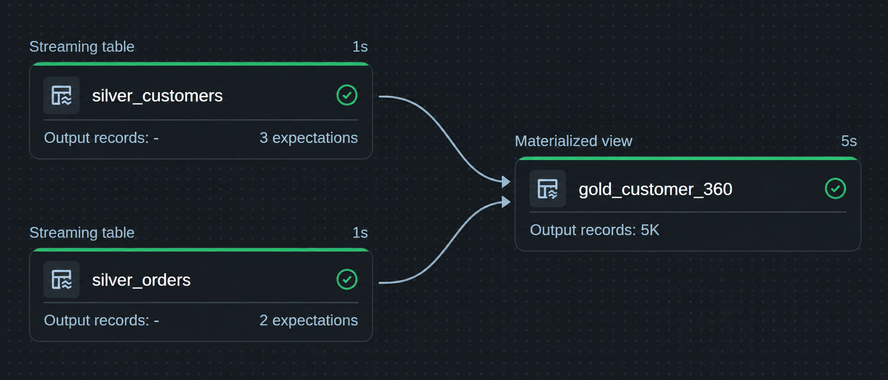

*Customer 360 transformation combining current customer records and order history to produce 5,000 customer-level records.*

### 📦 3. Product Performance – Merchandising

The Product Performance data mart combines product information, sales activity and inventory snapshots to provide an overview of product demand and stock availability.

It uses:

- `silver_order_items`
- `silver_products`
- `silver_inventory`

Sales activity is aggregated by product to calculate:

- **Units Sold:** Total quantity sold.
- **Revenue:** Sum of order-item line totals.

Inventory requires additional processing because the Silver inventory table preserves historical daily snapshots for each product and warehouse.

Instead of summing every historical snapshot, the transformation uses a **Spark window function** to identify the latest inventory record for each product and warehouse. The latest quantities are then aggregated across warehouses to calculate current stock per product.

A configurable stockout threshold of 20 units is applied:

```text
Stockout Risk = Current Stock < 20
```

Products falling below this threshold are flagged as being at risk of stockout. Products without an inventory snapshot are treated as having zero current stock.

The resulting data mart brings sales performance and current inventory together, helping Merchandising identify popular products with potentially insufficient stock.

### 📈 4. Funnel Analysis – Growth

The Funnel Analysis data mart uses `silver_clickstream` to measure website session conversions by marketing referrer.

Instead of attributing conversions directly to customer IDs, the transformation uses **session-level attribution**. This is important because website interactions can occur before a visitor identifies themselves or completes a purchase.

The transformation works in two stages:

1. **Session aggregation:** Events are grouped by `session_id` and `referrer`. A session is marked as converted if it contains at least one `purchase` event.
2. **Referrer aggregation:** Sessions are grouped by marketing referrer to calculate total sessions, converted sessions and conversion rate.

The resulting metrics are:

- **Total Sessions:** Number of sessions associated with each referrer.
- **Converted Sessions:** Number of sessions containing a purchase event.
- **Conversion Rate:** Converted sessions divided by total sessions.

Using session identifiers allows anonymous visitors to remain part of the analysis rather than excluding them because they have no associated customer ID.

The resulting view provides the Growth team with a consolidated way to compare website conversion performance across marketing referrers.

### 🚚 5. Fulfilment Health – Operations

The Fulfilment Health data mart analyses delivery performance using the current records from `silver_orders`.

It focuses on orders with a `delivered` status and calculates the time between the order date and the delivery-related timestamp.

A configurable Service Level Agreement (SLA) threshold of five days is applied:

```text
Days to Deliver =
    Delivery Timestamp - Order Date

Within SLA =
    Days to Deliver <= 5
```

The transformation aggregates results by order date and shipping region, producing:

- **Delivered Orders:** Number of delivered orders.
- **Within-SLA Orders:** Number of delivered orders meeting the five-day threshold.
- **SLA Compliance Rate:** Within-SLA orders divided by total delivered orders.

The resulting view provides Operations with visibility into delivery performance across dates and regions, rather than relying on individual order records.

### 🔗 Connecting Business Requirements to Analytical Outputs

The five Gold data marts complete the connection between the retailer's initial business challenges and the implemented Lakehouse solution.

| Business function | Analytical output | Business questions addressed |
|---|---|---|
| Finance | Daily Revenue | How much revenue was generated by date, category and region? |
| Marketing | Customer 360 | Who are the valuable customers, and who has become inactive? |
| Merchandising | Product Performance | Which products sell most, and which are approaching stockout risk? |
| Growth | Funnel Analysis | Which marketing referrers generate the most converting sessions? |
| Operations | Fulfilment Health | What proportion of delivered orders meet the delivery SLA? |

By separating these outputs into dedicated materialised views, the Gold layer provides a structured analytical foundation for different business functions without requiring them to repeatedly reconstruct the same transformations from raw operational data.

---

## 🛡️ Data Quality & Monitoring

ForwardStep implements a multi-layered data-quality framework to detect invalid records, monitor data consistency and prevent unreliable datasets from progressing through the Lakehouse unnoticed.

Rather than treating data quality as a single validation step, the implementation combines **row-level expectations, quarantine mechanisms, business-rule validation, referential-integrity monitoring and pipeline-level quality gates**.

Monitoring is supported through Databricks pipeline event logs, custom event hooks and a centralised Data Quality Dashboard covering both ingestion and transformation pipelines.

### 🧱 Bronze – Structural Data Quality & Quarantine

The Bronze layer applies structural quality expectations to all seven source datasets. These checks validate individual records against basic requirements such as mandatory identifiers, required fields, accepted values and numeric constraints.

The implementation uses Databricks `@dp.expect_all` to evaluate multiple expectations per source. Instead of dropping invalid records or stopping ingestion when an expectation fails, the quality-check step retains the records and calculates an `is_quarantined` flag.

A dedicated `quarantine_rule()` utility determines whether a record has failed at least one expectation.

Each source follows the same processing pattern:

```text
Raw Bronze Delta Table
          |
          v
Structural Quality Checks
          |
          v
   is_quarantined
          |
     +----+----+
     |         |
     v         v
   Valid    Quarantined
   Records   Records
     |         |
     v         v
  Silver    Monitoring
```

The quality-check tagging tables are kept private within the ingestion pipeline, while the resulting valid and quarantined tables are published for downstream consumption and monitoring.

Examples of implemented Bronze expectations include:

| Source | Structural validation |
|---|---|
| Orders | Order ID and customer ID must be present; total amount cannot be negative. |
| Order Items | Order-item ID, order ID and product ID must be present; quantity must be positive when supplied. |
| Customers | Customer ID and email must be present; loyalty tier must be an accepted value when supplied. |
| Products | Product ID and SKU must be present; retail price must be positive when supplied. |
| Categories | Category ID and category name must be present. |
| Clickstream | Event ID, event type and event timestamp must be present. |
| Inventory | Snapshot ID and product ID must be present; quantity on hand cannot be negative when supplied. |

Silver transformations consume the `*_valid` tables rather than the raw Bronze tables or private quality-check tables. Quarantined records remain available for investigation and monitoring.

<div style="
    width: min(94vw, 1600px);
    max-width: none;
    position: relative;
    left: 50%;
    transform: translateX(-50%);
    margin: 2rem 0;
">
    <a href="./bronze_valid_or_quarantined_l82.png" target="_blank" rel="noopener">
        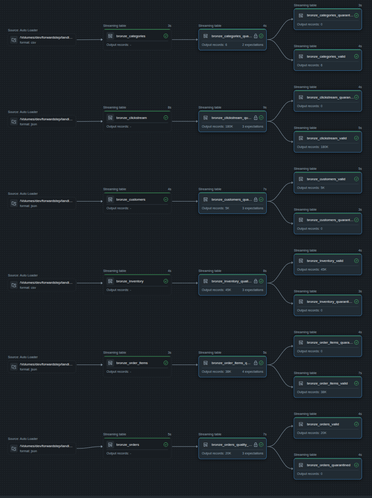
    </a>
</div>

*Bronze quality-check pipeline. Each source is evaluated independently and separated into valid and quarantined Delta tables. The captured execution shows zero quarantined records across the displayed sources.*

### ⚙️ Silver – Business-Rule Validation

The Silver layer introduces additional validation based on the meaning and relationships of the data, rather than just checking whether individual fields are populated.

Databricks expectation rules are applied to the relevant Silver datasets to monitor business-rule compliance.

Examples include:

- **Orders:** Accepted order statuses and consistency between discount codes and discount amounts.
- **Customers:** Valid loyalty tiers, registration dates that are not in the future, and a minimum customer age of 18.
- **Order Items:** Return requests must have an associated reason, and line totals must match quantity multiplied by unit price.
- **Products:** Retail prices must exceed product cost prices.
- **Clickstream:** Purchase events must reference an order, while product-view and add-to-cart events must reference a product.
- **Inventory:** Available quantity must equal quantity on hand minus reserved quantity, and reserved stock cannot exceed total stock.

Most of these Silver expectations are **report-only checks**. Their results are recorded for monitoring without automatically excluding the affected records.

The order-item line-total calculation is the exception because an incorrect financial value could directly distort Gold revenue calculations.

The implementation checks:

```text
ABS(line_total - (quantity × unit_price)) < 0.01
```

Records that fail this particular rule are separated into:

- `silver_order_items`: validated order items consumed by the Gold transformations.
- `silver_order_items_quarantined`: records with incorrect line totals, retained for investigation.

This provides targeted quarantine handling without unnecessarily excluding records that fail other report-only expectations.

### 🔗 Referential-Integrity Monitoring

In addition to individual record validation, ForwardStep monitors relationships between the Silver datasets.

The implementation contains **eight referential-integrity checks**, using SQL anti-joins to identify orphaned records that reference entities that do not exist in the corresponding parent dataset.

| Relationship | Referential-integrity check |
|---|---|
| Orders → Customers | Every order must reference an existing customer. |
| Order Items → Orders | Every order item must reference an existing order. |
| Order Items → Products | Every order item must reference an existing product. |
| Products → Categories | Every product must reference an existing category. |
| Inventory → Products | Every inventory record must reference an existing product. |
| Clickstream → Products | Non-null product references must correspond to existing products. |
| Clickstream → Customers | Non-null customer references must correspond to existing customers. |
| Clickstream → Orders | Non-null order references must correspond to existing orders. |

For relationships involving SCD Type 2 parent tables, the checks compare against the current parent record using `__END_AT IS NULL`. Nullable references in clickstream data are checked only when a value is present.

The checks use anti-joins rather than enforced foreign-key constraints. This allows relationships to be monitored independently of ingestion timing, where related records may arrive through separate data streams.

### 📊 Data Quality Dashboard

To make data quality observable across both pipelines, I implemented a Databricks dashboard backed by three SQL views:

- `dq_expectations_history`
- `dq_quarantine_counts`
- `dq_referential_integrity`

The setup notebook retrieves event logs from the ingestion and transformation pipelines separately, then combines their expectation results into a unified monitoring view.

The dashboard is organised into three main areas:

#### Expectations

Tracks expectation results from both Bronze and Silver, including passed records, failed records and failure rates.

The failure rate is calculated as:

```text
Failure Rate (%) =
    Failed Records
    / (Passed Records + Failed Records)
    × 100
```

This provides visibility into which datasets and validation rules experience quality issues over time.

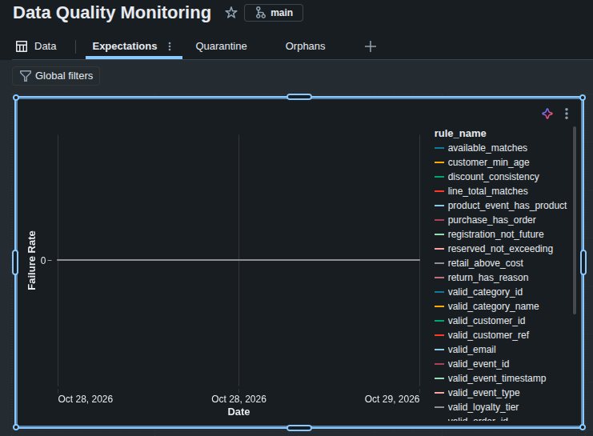

*Expectation monitoring displaying validation rules from the ingestion and transformation pipelines.*

#### Quarantine

Tracks quarantined record counts across **eight quarantine tables**: seven Bronze outputs and the Silver order-item quarantine table.

This provides visibility into the volume of records excluded from downstream processing and helps identify unusual increases in rejected data.

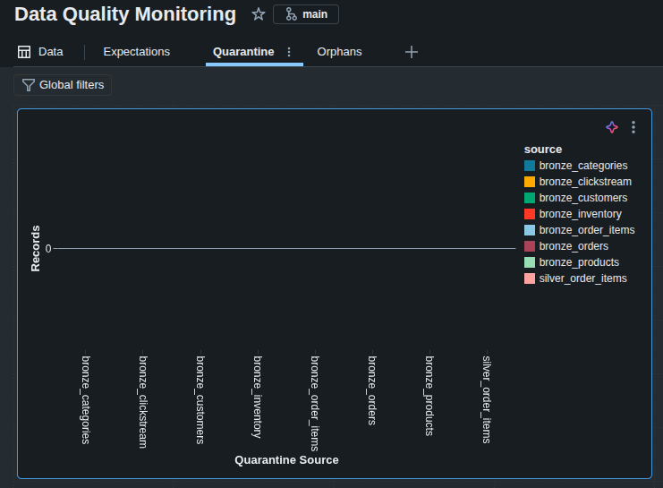

*Quarantine monitoring across the seven Bronze sources and the Silver order-item output. The captured dashboard snapshot shows zero quarantined records.*

#### Referential Integrity

Displays the orphaned-record count for each of the eight monitored relationships, together with the latest check timestamp.

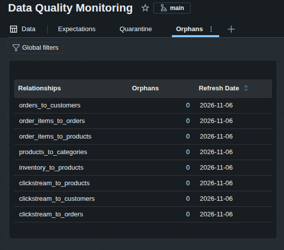

*Referential-integrity monitoring showing zero orphaned records across all eight relationships in the captured execution.*

### 🚨 Pipeline Event Hooks & Alert Thresholds

In addition to dashboard-based monitoring, the project implements Databricks pipeline event hooks in both the ingestion and transformation pipelines.

The hooks listen for `flow_progress` events and inspect the expectation results reported in the pipeline event logs.

For each expectation, the alert logic calculates the failure rate and checks whether it exceeds a configurable **25% threshold**.

When the threshold is exceeded, the hook generates an alert message identifying the affected pipeline, dataset, expectation and failure rate.

The event hooks are registered with `max_allowable_consecutive_failures=3`, limiting repeated hook failures.

The current `send_alert()` implementation prints the generated alert message rather than sending it to an external notification service such as Slack or PagerDuty.

### 🛑 Job-Level Data Quality Gate

A separate data-quality gate provides an additional safeguard between ingestion and transformation.

Implemented in `jobs/dq_check.py`, the gate executes after the ingestion pipeline and before the Silver transformation pipeline.

It performs two checks against the current processing date:

1. **Ingestion completeness:** Every one of the seven Bronze tables must contain at least one record ingested on the current run date.
2. **Quarantine-rate threshold:** The quarantine rate for each of the seven Bronze sources must not exceed 50% for records ingested on that date.

If either condition fails, the notebook raises an exception and the quality-check task fails. Because the transformation task depends on its successful completion, downstream processing does not proceed on top of an unhealthy ingestion run.

This creates two complementary levels of protection: individual records are evaluated through row-level expectations, while the job-level gate determines whether an entire ingestion run is healthy enough to continue.

---

## 🔄 Pipeline Orchestration

ForwardStep combines its ingestion and transformation pipelines into a single **Databricks Job**, coordinating the complete data processing workflow from Bronze ingestion to Gold analytics.

The orchestration is implemented using four dependent tasks, ensuring that each processing stage executes only after its prerequisite has completed successfully.

An additional job-level data quality gate sits between ingestion and transformation, preventing downstream processing when an ingestion run indicates a systemic problem. A final reporting task produces a summary of the pipeline execution, providing visibility into the resulting datasets and quarantine counts.

### 🏗️ Four-Task Workflow

The `forwardstep-orchestration-job` coordinates four tasks in a sequential workflow:

| Task | Execution type | Responsibility |
|---|---|---|
| `run_ingestion` | Databricks Pipeline Task | Executes the Bronze ingestion pipeline and produces raw, valid and quarantined Bronze tables. |
| `dq_check` | Notebook Task | Evaluates ingestion completeness and quarantine rates for the current run. |
| `run_transformation` | Databricks Pipeline Task | Executes Silver transformations and generates the five Gold analytical data marts. |
| `report` | Python Script Task | Produces a post-run summary of Bronze, Silver and Gold record counts and quarantine statistics. |

Here is how the orchestration job executes in Databricks:

<div style="
    width: min(94vw, 1600px);
    max-width: none;
    position: relative;
    left: 50%;
    transform: translateX(-50%);
    margin: 2rem 0;
">
    <a href="./orchestration.png" target="_blank" rel="noopener">
        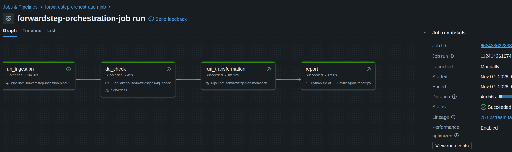
    </a>
</div>

*Databricks Job configuration showing the ingestion pipeline, data quality notebook, transformation pipeline and final Python reporting task.*

### 📊 Post-Run Reporting

The final task executes `jobs/report.py` as a Spark Python task after the transformation pipeline completes successfully.

The script produces a lightweight execution summary directly in the Databricks Job run logs.

It reports:

- **Bronze:** Total record counts across seven tables, including records ingested on the current run date.
- **Silver:** Total record counts across seven transformed tables.
- **Gold:** Total record counts across five analytical materialised views.
- **Quarantine:** Quarantined record counts and rates for all seven Bronze sources, plus the Silver order-item quarantine statistics.

The report distinguishes between processing-time and business-time information. Bronze records contain `_ingested_at`, allowing counts to be filtered by the current run date. Silver and Gold outputs do not provide the same consistent processing-time field, so their summaries report total counts instead.

The reporting task also receives the target catalog and run date as parameters, ensuring that the summary queries the appropriate environment.

This provides an immediate operational snapshot after a successful job execution without requiring someone to inspect every individual pipeline manually.

### ⚙️ Parameterisation & Environment Support

The orchestration job uses a job-level `run_date` parameter, defaulting to the Databricks job start date:

```text
{{job.start_time.iso_date}}
```

This provides a consistent execution date for tasks that require run-specific processing, without relying on hard-coded dates.

The target catalog is supplied through the Databricks Asset Bundle configuration. The same orchestration definition can therefore reference the appropriate catalog and deployed pipeline resources across development, UAT and production.

The reporting task receives its parameters as command-line arguments, while the data-quality notebook uses Databricks notebook widgets.

By combining reusable job parameters with explicit task dependencies, the orchestration layer coordinates the pipelines while keeping environment-specific configuration separate from the processing logic.

---

## 🧪 Testing Strategy

ForwardStep incorporates automated testing throughout the development and deployment lifecycle to validate transformation logic, verify interactions between deployed Databricks resources, and check production deployment health.

The testing strategy is organised into three levels:

- **Unit Testing:** Validates individual Python and Spark transformation functions using controlled test data.
- **Integration Testing:** Executes the deployed pipelines and orchestration workflow against a dedicated UAT environment using deterministic test data.
- **Production Smoke Testing:** Performs non-destructive checks after deployment to verify that production resources are available and operational.

The implementation uses **PyTest, PySpark testing utilities, the Databricks SDK, and GitHub Actions** to execute these checks.

### 🧩 1. Unit Testing

Unit tests are organised separately for the ingestion and transformation pipelines, following the repository's modular structure.

Tests use small, manually constructed datasets with known expected outputs, allowing individual pieces of logic to be evaluated without depending on a complete Databricks pipeline execution.

**Ingestion Pipeline Tests**

The ingestion test suite focuses on the `quarantine_rule()` utility, which constructs a SQL expression from multiple data-quality expectations.

Two test cases verify:

- **Multiple Rules:** Confirms that multiple expectation conditions are correctly combined into a single quarantine expression.
- **Empty Rule Handling:** Ensures that an empty rules dictionary raises a clear `ValueError` instead of producing invalid SQL.

These tests cover both the expected behaviour and an important edge case in the quarantine logic.

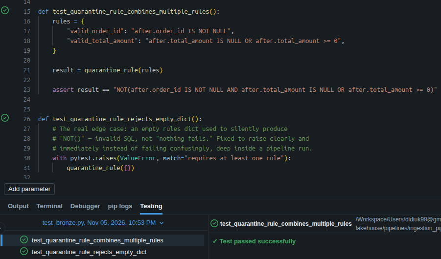

*Ingestion unit tests: both quarantine-rule test cases passed successfully.*

**Transformation Pipeline Tests**

The transformation test suite focuses on the five Gold-layer business-logic functions. A local Spark fixture provides a reusable SparkSession, allowing the tests to run without requiring a Databricks cluster.

The suite contains six test cases covering the following scenarios:

| Transformation | Test scenario | Behaviour verified |
|---|---|---|
| Daily Revenue | Proportional discount allocation and SCD Type 2 filtering | Correct discount distribution and exclusion of superseded order versions. |
| Daily Revenue | Zero order subtotal | Prevents division-by-zero errors when allocating discounts. |
| Product Performance | Latest inventory snapshots and NULL handling | Selects the latest snapshot per product and warehouse and handles missing inventory. |
| Customer 360 | Deterministic calculation | Produces consistent customer metrics using a fixed as-of date. |
| Funnel Analysis | Anonymous sessions | Includes converting sessions even when no customer ID is available. |
| Fulfilment Health | Inclusive SLA boundary | Counts orders delivered within exactly five days as meeting the SLA and excludes undelivered orders. |

Expected Spark DataFrames are compared against the actual transformation outputs using PySpark's `assertDataFrameEqual` utility.

The tests use controlled records to isolate specific business rules, including historical-record filtering, inventory selection, discount allocation and SLA calculations.

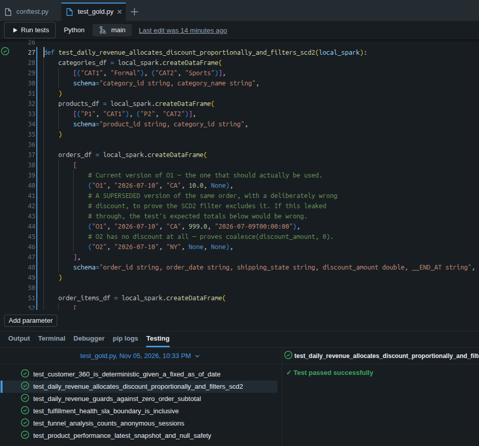

*Transformation unit tests: all six Gold business-logic test cases passed successfully.*

### 🔗 2. Integration Testing – UAT Environment

Unit tests validate individual functions, but they do not establish whether the deployed ingestion pipeline, transformation pipeline and orchestration job work correctly together.

To address this, ForwardStep includes an **end-to-end integration test against the deployed UAT environment**, implemented using PyTest and the Databricks SDK.

The test follows a controlled three-stage process:

#### Setup – Deterministic Test Data

A dedicated test dataset is generated using the Python data generator with a fixed configuration:

- Random seed
- As-of date
- 20 customers
- 50 orders
- 15 products
- 200 clickstream events
- 2 inventory snapshot days

The generated dataset also includes 6 categories and 101 order items, with 90 inventory records across three warehouses.

Before the test starts, the UAT landing-volume contents are cleared to prevent files from previous test executions from being processed again.

The new test batch is then uploaded into the corresponding source folders within the UAT landing volume.

#### Trigger – Execute the Deployed Pipelines

Using the Databricks SDK, the test identifies the deployed UAT resources and triggers the ingestion and transformation pipelines with full refreshes.

Once both pipeline updates have completed, the test executes the orchestration job through the Databricks Jobs API.

The successful completion of the orchestration job is asserted as part of the integration test.

#### Validate – Verify Processing Results

After execution, the test queries the deployed Bronze tables through Databricks SQL.

For categories, customers, products and orders, it verifies that the total number of records across the valid and quarantined outputs matches the expected generated input count.

This acts as a **row-conservation check**, ensuring that incoming records are accounted for rather than silently disappearing during ingestion or quality processing.

The same four source datasets are also checked for zero quarantined records in the controlled test run.

The integration test therefore validates both successful end-to-end orchestration and the expected handling of selected Bronze source records.

### 🚀 3. Production Smoke Testing

Following production deployment, a separate smoke-test suite performs **non-destructive checks** against the production Databricks workspace.

Unlike integration testing, this suite does not upload test data, clear landing volumes, trigger full refreshes or modify production tables.

Its purpose is to verify that the deployed platform is accessible and in a healthy state.

The checks cover:

- **Pipeline Availability:** Confirms that the ingestion and transformation pipelines exist and are reachable.
- **Pipeline Execution Health:** Checks that the latest pipeline updates, when available, have not failed or been cancelled.
- **Job Availability:** Confirms that the orchestration job exists and can be accessed.
- **Dashboard Availability:** Verifies that the deployed Data Quality Dashboard is reachable.
- **Gold Table Accessibility:** Executes SQL count queries against all five Gold analytical tables to confirm that they are queryable.

Actual Gold record counts are logged for inspection but are not treated as pass/fail conditions. This is intentional: a newly deployed production environment may legitimately contain no business records until real source data arrives.

The smoke tests therefore distinguish between **deployment health and data volume**, avoiding false failures on a newly provisioned production environment.

The suite is executed through the separate production deployment workflow, providing a final validation step after the deployment and environment bootstrap stages.

---

## 🚀 CI/CD & Deployment

ForwardStep implements a deployment workflow combining **GitHub Actions and Databricks Asset Bundles (DABs)** to package, validate and deploy the Lakehouse resources across development, UAT and production environments.

The deployment configuration centralises the definitions of the ingestion and transformation pipelines, orchestration jobs, data quality dashboard and environment bootstrap job. Environment-specific variables determine the target catalog, workspace and SQL warehouse configuration without requiring changes to the underlying pipeline code.

The implementation separates automated testing and UAT deployment from production promotion, introducing a manual confirmation step before changes are deployed to the production workspace.

### 📦 1. Databricks Asset Bundles

The project uses **Databricks Asset Bundles** to package and manage the deployment of the Lakehouse resources.

The central configuration is defined in:

`bundle/databricks.yml`

The bundle includes the following resources:

- Ingestion pipeline.
- Transformation pipeline.
- Orchestration job.
- Data Quality Dashboard.
- Environment bootstrap job.

It also synchronises the pipeline transformations, utility functions, job scripts, setup notebooks and monitoring resources into the target Databricks workspace.

The same resource definitions are reused across the three deployment targets. A configurable `forwardstep_catalog` variable determines which Unity Catalog catalog the deployed resources use, while the SQL warehouse ID is configured separately for the target environment.

Before deployment, the bundle is validated using:

```bash
databricks bundle validate --target uat
```

Once validation succeeds, deployment is performed using:

```bash
databricks bundle deploy --target uat
```

The target can be changed to `dev` or `prod`, allowing the same project configuration to be deployed across environments.

### 🌐 2. Environment Separation

ForwardStep uses three deployment targets with different levels of isolation:

| Environment | Databricks Workspace | Unity Catalog | Purpose |
|---|---|---|---|
| Development | Shared development/UAT workspace | `dev` | Development and pipeline implementation. |
| UAT | Shared development/UAT workspace | `uat` | Deployment validation and integration testing. |
| Production | Separate Databricks workspace | `prod` | Production deployment and scheduled execution. |

Development and UAT use the same Databricks workspace but maintain separate Unity Catalog catalogs. Production runs in a completely separate workspace with its own catalog.

This configuration provides logical data isolation between development and UAT while keeping production infrastructure separated from development activities.

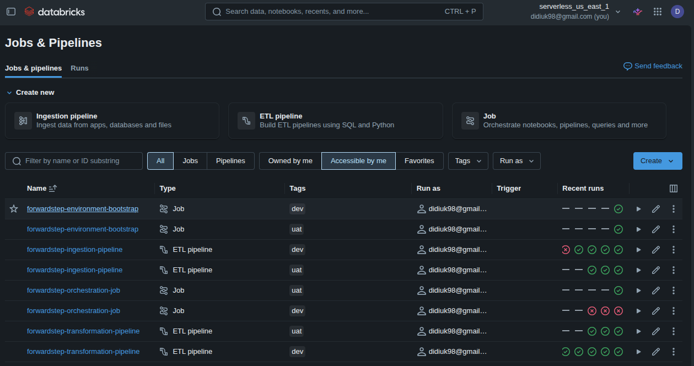

*Databricks Jobs & Pipelines showing development and UAT resources identified through environment-specific tags.*

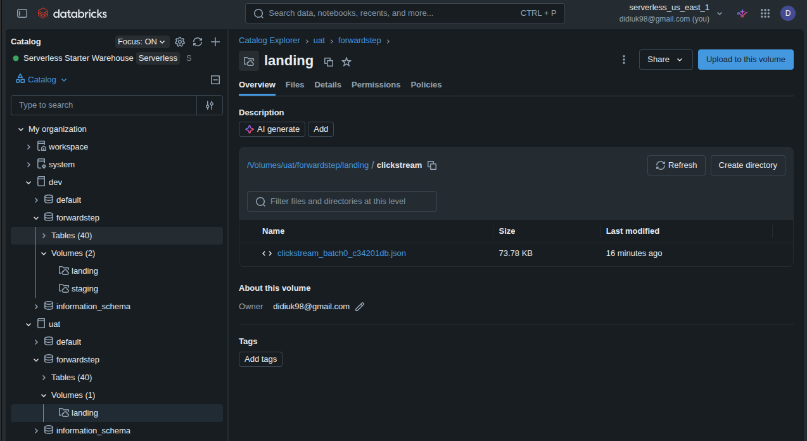

*Separate development and UAT catalogs, each maintaining its own project schema and managed volumes.*

### 🏗️ 3. Environment Bootstrap

To prepare a newly deployed target environment, the project includes a dedicated **environment bootstrap job**.

The bootstrap process is designed to be idempotent, allowing it to be executed again without recreating or overwriting existing resources.

It coordinates five tasks:

1. **Environment Setup:** Creates the target schema, landing volume and seven source-specific landing directories.
2. **Initial Ingestion:** Executes the ingestion pipeline to initialise the Bronze tables.
3. **Initial Transformation:** Executes the transformation pipeline to initialise the Silver and Gold outputs.
4. **Event Log Setup:** Creates separate event-log views for the ingestion and transformation pipelines.
5. **Dashboard Setup:** Configures the Data Quality Dashboard for the target environment.

<div style="
    width: min(94vw, 1600px);
    max-width: none;
    position: relative;
    left: 50%;
    transform: translateX(-50%);
    margin: 2rem 0;
">
    <a href="./env_bootstrap_job.png" target="_blank" rel="noopener">
        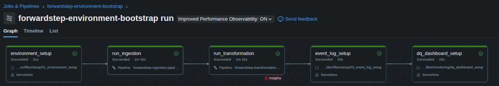
    </a>
</div>

*Environment bootstrap execution showing the five dependent setup tasks, from schema and landing-zone preparation through initial pipeline execution and monitoring configuration.*

The bootstrap job is included in the Databricks Asset Bundle and executed after resource deployment, making the environment setup repeatable across targets.

For UAT, the deployment workflow ensures that the target catalog exists before deploying the bundle. The production catalog is created manually once in the production workspace before its initial bundle deployment.

### 🔄 4. GitHub Actions – Automated UAT Deployment

The UAT deployment workflow is implemented in:

`.github/workflows/ci.yml`

It coordinates three sequential GitHub Actions jobs:

#### Stage 1 – Unit Testing

The workflow first executes the ingestion and transformation pipeline unit tests on a GitHub-hosted Ubuntu runner using Python 3.12, PyTest and PySpark.

Both test suites are executed separately. If either suite fails, the subsequent deployment job does not run.

#### Stage 2 – Validate & Deploy UAT

After successful unit testing, GitHub Actions:

- Configures authentication using GitHub repository secrets.
- Ensures that the target UAT catalog exists.
- Validates the Databricks Asset Bundle configuration.
- Deploys the bundle to the UAT target.
- Executes the environment bootstrap job.

Separating authentication details from the workflow configuration avoids hardcoding Databricks workspace credentials or access tokens in the repository.

#### Stage 3 – Integration Testing

Once the UAT deployment and bootstrap process complete successfully, GitHub Actions executes the PyTest integration suite against the deployed UAT resources.

The integration test uses the Databricks SDK to interact with the workspace and validate the deployed pipelines and orchestration workflow.

The workflow therefore establishes the following sequence:

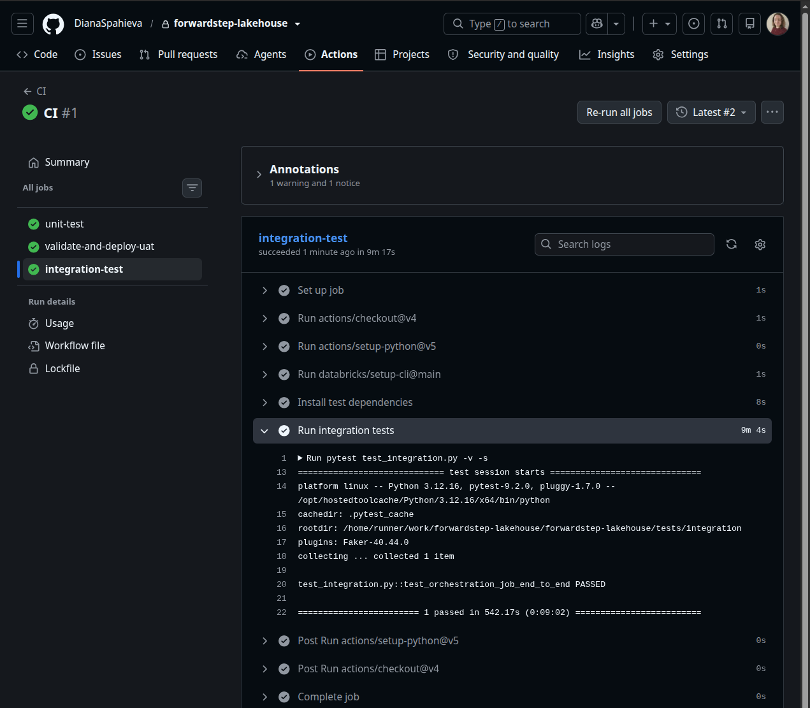

*Successful GitHub Actions execution. All three jobs completed successfully, including the UAT deployment and end-to-end integration test.*

The current UAT workflow is configured for manual execution through GitHub Actions using `workflow_dispatch`.

### 🔐 5. Controlled Production Deployment

Production deployment is handled through a separate GitHub Actions workflow:

`.github/workflows/deploy-prod.yml`

Unlike the UAT workflow, production deployment is not triggered automatically by repository changes. Instead, it requires an explicit manual invocation from the `main` branch.

An additional confirmation input requires the exact phrase:

`DEPLOY PROD`

The deployment proceeds only when this confirmation matches.

Once confirmed, the workflow performs four steps:

1. **Validate Bundle:** Checks the Databricks Asset Bundle configuration for the production target.
2. **Deploy Resources:** Deploys the configured pipelines, jobs and dashboard to the separate production workspace.
3. **Environment Bootstrap:** Executes the production bootstrap job to initialise the schema, landing volume, pipelines, event-log views and dashboard.
4. **Production Smoke Tests:** Runs the non-destructive smoke-test suite against the deployed production resources.

Production deployment uses separate GitHub repository secrets for production workspace authentication.

The production catalog is pre-created manually before the initial deployment. Subsequent environment setup and resource deployment are handled through the automated workflow.

The production workflow is deliberately separate from the UAT CI workflow. It provides a manually controlled promotion mechanism rather than automatically deploying to production whenever the UAT workflow completes.

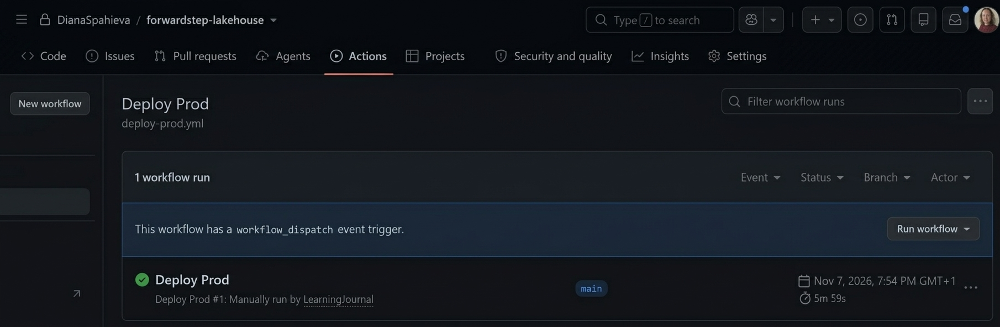

*Successful production deployment of ForwardStep through the manually triggered Deploy Prod workflow.*


Separately from the bundle-managed deployment, the production orchestration job was configured directly in the production Databricks workspace with a recurring execution schedule and job-failure notifications.

---

## 🧠 Technical Skills Demonstrated

### 🏗️ Lakehouse Architecture & Platform Design

- End-to-End Lakehouse Architecture Design
- Medallion Architecture (Bronze, Silver, Gold)
- Cloud Data Platform Design
- Unity Catalog Organisation & Data Governance
- Databricks-Managed Volumes & Data Organisation
- Multi-Environment Architecture (Development, UAT, Production)

### 📥 Data Engineering & Processing

- Incremental Data Ingestion
- Change Data Capture (CDC) Processing
- Auto Loader & Schema Management
- Distributed Data Processing with Apache Spark
- PySpark DataFrame Transformations
- ETL / ELT Pipeline Development
- Delta Lake & Materialised Views
- Slowly Changing Dimensions (SCD Type 1 & Type 2)
- Historical Data Management
- Append-Only Data Processing

### 📊 Data Modelling & Analytics Engineering

- Analytical Data Mart Development
- Multi-Source Data Integration
- Complex Joins & Aggregations
- Business Metric Calculation
- Revenue & Discount Allocation
- Customer-Level Analytical Modelling
- Inventory & Product Performance Analytics
- Session-Based Conversion Analysis
- Fulfilment SLA Reporting

### 🛡️ Data Quality & Observability

- Declarative Data Quality Expectations
- Record Validation & Quarantine Handling
- Business-Rule Validation
- Referential-Integrity Monitoring
- Anti-Join Validation
- Pipeline Event-Log Analysis
- Event-Driven Monitoring & Alert Thresholds
- Data Quality Dashboard Development
- Job-Level Data Quality Gates

### 🔄 Workflow Orchestration & Automation

- Databricks Job Orchestration
- Multi-Task Workflow Dependencies
- Parameterised Pipeline Execution
- Cross-Environment Configuration
- Automated Pipeline Run Reporting
- Scheduled Production Workflows

### 🧪 Testing & CI/CD Engineering

- PyTest Unit Testing
- PySpark DataFrame Testing
- Deterministic Test Data Generation
- End-to-End Integration Testing
- Production Smoke Testing
- Git-Based Development Workflows
- CI/CD Pipeline Development
- Databricks Asset Bundle Configuration & Deployment
- Environment-Specific Deployment
- Controlled Production Promotion
- Automated Deployment Validation

---

## 📦 Technologies

### 🏢 Cloud Data Platform
- Databricks Lakehouse Platform
- Unity Catalog
- Databricks-Managed Volumes
- Databricks Auto Loader 
- Spark Declarative Pipelines
- Databricks Jobs & Workflows
- Databricks SQL & Lakeview Dashboards

### ⚡ Data Processing & Storage
- Apache Spark
- PySpark
- Spark SQL
- Delta Lake
- Delta Tables & Materialised Views

### 🐍 Programming & Data Generation
- Python
- Faker
- JSON
- CSV

### 🧪 Testing & Development
- PyTest
- PySpark Testing Utilities
- Databricks SDK for Python

### 🚀 DevOps & Deployment
- Git
- GitHub
- GitHub Actions
- Databricks CLI
- Declarative Automation Bundles (DABs)
- YAML Configuration